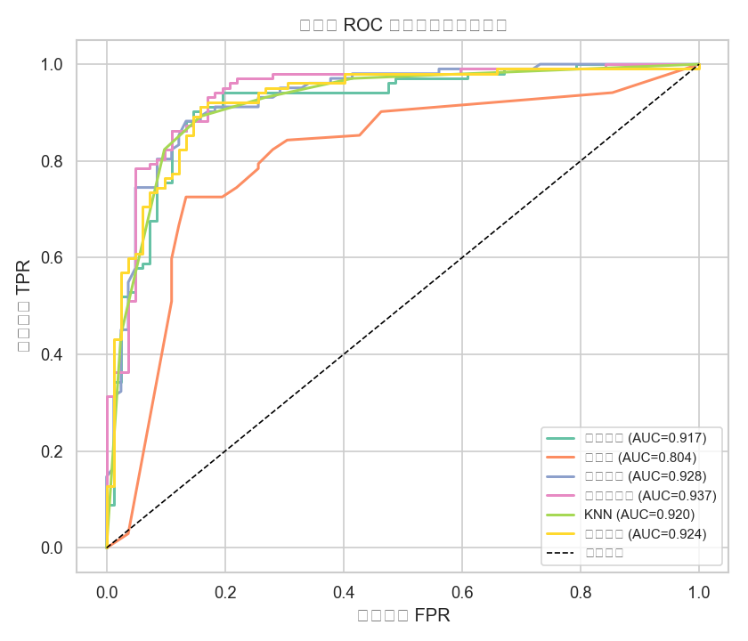
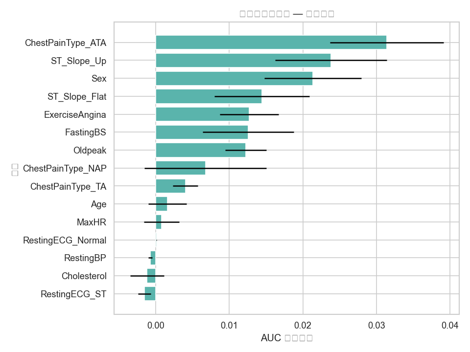
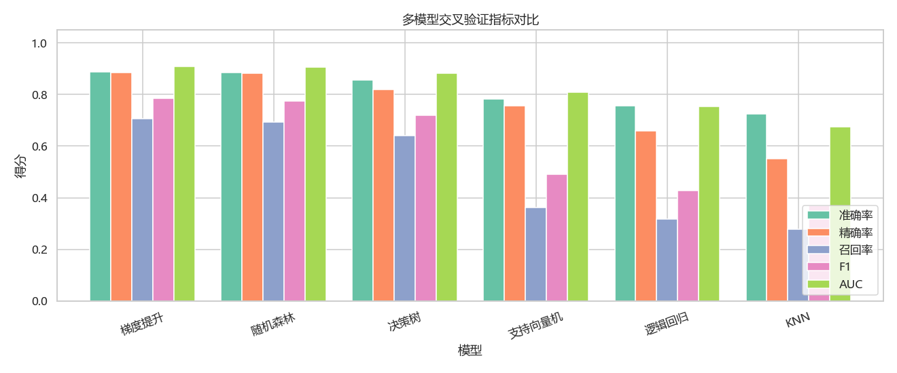
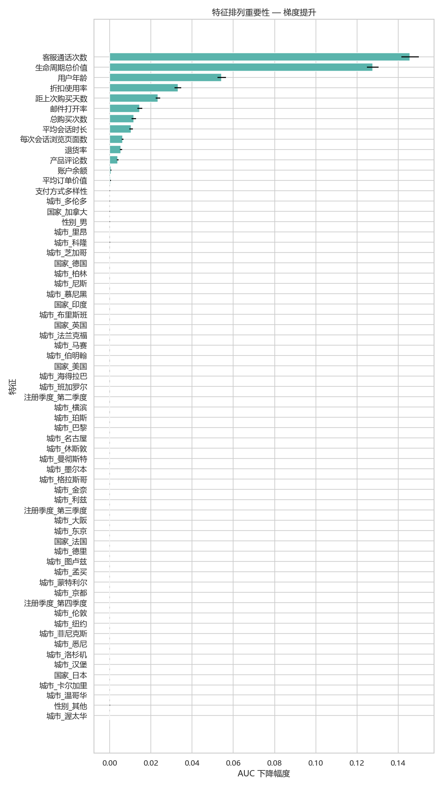

# 数据分析课程作业集

深圳职业技术大学 · 《数据分析实务实训》课程作业汇总

本仓库收录四个相互独立的实操项目，涵盖数据获取与清洗、探索性分析（EDA）、机器学习建模与调优、成果报告的完整流程。所有项目采用同一套目录约定，便于对照阅读与复现。

作者：赵书鹏（240200341）

---

## 目录约定

每个项目一个文件夹，内部结构固定：

| 目录 | 存放内容 |
| --- | --- |
| `data/` | 原始数据，以及清洗后生成的数据 |
| `img/` | 项目配图与模型输出图表 |
| `code/` | Python 脚本（`.py`） |
| `产出/` | 分析报告、结果表、实验日志、任务书 |
| `*.ipynb` | 项目主 Notebook，置于项目根目录 |

## 项目一览

| 项目 | 主题 | 核心方法 | 关键结果 |
| --- | --- | --- | --- |
| 北上广深等八城地铁运营效能分析 | 8 城轨道交通运营数据的规模与效率对比 | 数据清洗、描述性统计、规模-效率四象限分析 | 深圳"小而强"、成都"大而弱"、重庆"小且弱" |
| 心脏病发病预测 | 基于临床指标预测是否患病（二分类） | 6 种模型 + 5 折交叉验证 + 网格/随机搜索调参 | 逻辑回归最优，测试集 AUC 0.919、召回率 0.902 |
| 电商客户流失分析 | 基于用户行为预测是否流失（二分类） | 同上，另含聚类画像与阈值优化 | LightGBM 调参后 AUC 0.905、F1 0.781（阈值 0.39） |
| notebook基本使用 | Jupyter / NumPy / Pandas / Matplotlib 课程练习 | 课堂实训与综合复习 | 11 个练习 Notebook |

---

## 项目一 · 北上广深等八城地铁运营效能分析

分析北京、上海、广州、深圳、成都、武汉、杭州、重庆 8 座城市的地铁运营规模与效率关系。

**数据**

- `data/8城轨道交通运营数据_202501-202605.csv`：2025 年 1 月 — 2026 年 5 月逐月运营数据，字段含运营里程（km）、客运量（万人次）、进站量（万人次）、客运强度（万人次/km·日）、线路开通备注
- `data/8城核心数据_2025.csv`：各城市占地面积、建成区面积、常住人口、建成区常住人口
- `data/*_clear.csv`：清洗与类型转换后的版本
- 数据来源：中国城市轨道交通协会年度统计报告、交通运输部月度运营数据速报、各城市地铁官网、国家统计局统计公报

**分析流程**

数据读取 → 字段含义梳理 → 缺失值与数据类型检查 → 月份格式转换 → 清洗结果落盘 → 线路图呈现 → 规模-效率可视化 → 四象限定位

**主要结论**

以运营里程中位数 677.0 km、客运强度中位数 1.0227 万人次/(km·日) 划分四象限：

- **深圳**：唯一落在"低规模高效率"象限，客运强度断层领先，是紧凑城市形态下的效率标杆
- **成都**：唯一落在"高规模低效率"象限，线网扩张快于客流培育，需从增量扩张转向存量提质
- **重庆**：低规模低效率，受山地地形制约，规模尚待补强，并非规划失当
- **北京、上海、广州**：高规模高效率，其中京沪已进入存量优化平台期，边际效益递减

**产出**：`北上广深等8城地铁运营效能数据分析报告.ipynb`；8 张城市线路图见 `img/`

---

## 项目二 · 心脏病发病预测

依据实训任务书流程，用临床指标预测受检者是否患病。

**数据**：`data/heart.csv`，1303 条记录、12 个字段（年龄、性别、胸痛类型、血压、胆固醇、空腹血糖、静息心电图、最大心率、运动诱发心绞痛、Oldpeak、ST 段斜率、血管阻塞数）

**处理与建模**

1. 数据探查：缺失值、重复值、异常值、类别取值检查，清洗后保留 **917 条**
2. EDA：目标分布、数值特征分组分布、类别特征患病率、相关性热力图、Oldpeak 与 MaxHR 深挖
3. 建模对比：逻辑回归、决策树、随机森林、SVM、KNN、梯度提升，5 折交叉验证
4. 调优评估：GridSearchCV 网格搜索 + RandomizedSearchCV 对照，测试集评估、混淆矩阵、ROC 曲线、特征重要性

**关键结果**

| 指标 | 数值 |
| --- | --- |
| 最优模型 | 逻辑回归（C=0.1） |
| 交叉验证 AUC | 0.9212 |
| 测试集 AUC | 0.919 |
| 召回率 | 0.902 |
| 准确率 | 0.875 |
| 漏诊 / 误诊 | 10 例 / 13 例 |

主要风险特征：胸痛类型、ST 段斜率、性别、Oldpeak。医疗场景漏诊代价高于误诊，部署时应下调分类阈值以优先保证召回率。





**产出**：主 Notebook、`产出/心脏病发病预测-实训任务书.docx`、9 张分析图见 `img/`

---

## 项目三 · 电商客户流失分析

预测电商用户是否流失，并对用户做聚类画像辅助运营决策。

**数据**

- `data/rawData.csv`：训练集，40450 行、19 个字段，目标列 `Churned`（1=流失，0=留存，流失率约 28.9%）
- `data/测试集.csv`：5000 行验证集，无目标列
- `data/验证集1-发学生.csv`：课程下发的验证集
- `data/数据字典.docx`：字段含义说明

**处理与建模**

1. 清洗：缺失、重复、目标分布、异常值检查，训练集与验证集采用同一套规则
2. EDA：目标分布、数值特征分组分布、类别特征流失率、相关性热力图、重点特征深挖
3. 六模型对比：逻辑回归、决策树、随机森林、SVM、KNN、梯度提升，5 折交叉验证
4. 改良优化：换用 XGBoost / LightGBM / ExtraTrees / AdaBoost 二次选型，网格调参 + 分类阈值优化，并以 v2 输出避免覆盖基线结果
5. 聚类分析：K 值选择、簇画像、方案对比

**关键结果**

| 指标 | 数值 |
| --- | --- |
| 冠军模型 | LightGBM（lr=0.03, num_leaves=15, n_estimators=400） |
| 交叉验证 AUC | 0.9138 |
| 测试集 AUC | 0.9053 |
| 最优阈值 | 0.39 |
| 对应 F1 | 0.781 |

预测输出保留验证集原始行号，便于逐行核对。





**产出**：主 Notebook；`产出/` 内含分析报告 docx、代码讲解 md、模型优化实验记录、调参日志、`prediction_result.csv` 与 `prediction_result_v2.csv`、聚类结果表；脚本见 `code/`

---

## 项目四 · notebook基本使用

课程配套练习合集，覆盖 Jupyter 基本操作、NumPy 数组运算、Pandas 数据读写与合并分组、Matplotlib 绘图、文件读写等。11 个 Notebook 按课堂章节组织：

`JupyterNotebook使用概要` · `第二部分课堂实训` · `第三部分课堂实训` · `第四部分课堂实训` · `第五部分课堂实训` · `第六部分 泰坦尼克号乘客数据分析`（含报告版）· `期末作业` · `zuoye` · `常用代码` · `综合复习`

数据位于 `data/`（含 Titanic、iris、tips、scores、babynames 等教学数据集），配图见 `img/`。

---

## 运行环境

- Python 3.8+（Anaconda 发行版即可）
- 主要依赖：`numpy`、`pandas`、`matplotlib`、`seaborn`、`scikit-learn`、`xgboost`、`lightgbm`、`nbformat`
- Jupyter Notebook 或 VS Code（Python + Jupyter 扩展）

## 复现说明

1. 进入某个项目文件夹，**在该目录下启动 Jupyter**（工作目录必须是项目根目录，代码内的 `data/`、`img/` 均为相对路径）
2. 按顺序执行 Notebook 单元格；图表会自动写入 `img/`，结果文件写入 `产出/`
3. `code/` 下的脚本可独立运行，`churn_analysis.py` 会自动定位项目根目录，无需手动改路径

```bash
cd 心脏病发病预测
jupyter notebook 心脏病发病预测_数据分析.ipynb
```

## 说明

- 各项目 `data/` 内的原始数据仅用于课程学习，版权归原数据提供方所有
- 部分体积较大的素材（地铁线路图原图、babynames 数据集）未纳入版本控制，详见 `.gitignore`；如需完整复现，从原始来源补齐即可
